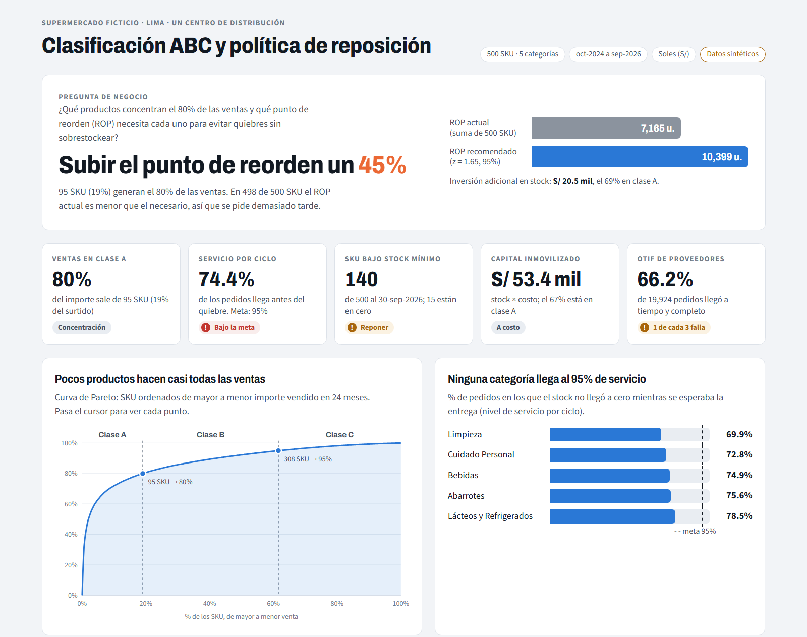
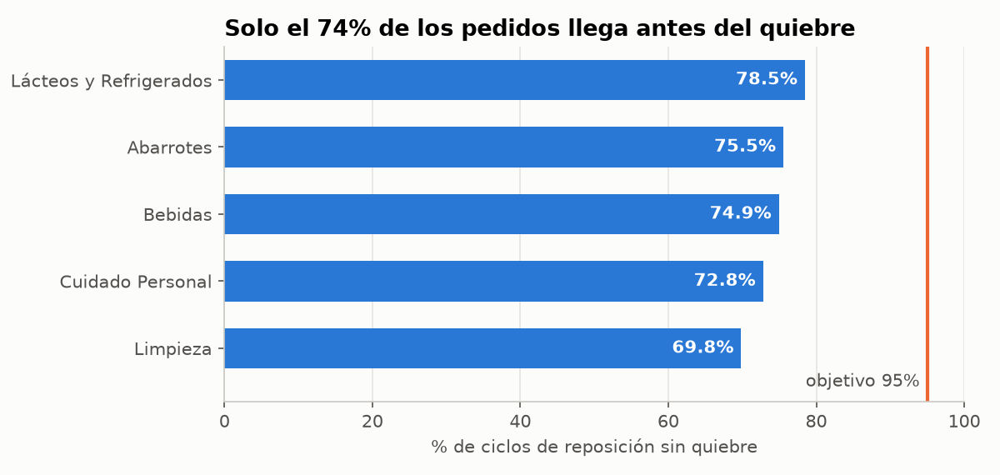
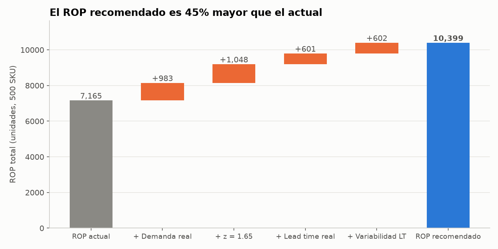

# Clasificación ABC y política de reposición de inventario

Análisis de inventario de un supermercado **ficticio** de Lima (500 SKU, 24 meses). **Resultado:** la política de reposición actual solo evita el quiebre en el 74% de los pedidos; subir el punto de reorden un 45% (S/ 20.5 mil, 69% en clase A) permite apuntar a un 95% de nivel de servicio.



> Los datos son **sintéticos**, generados con `src/generar_datos.py`. Las marcas y los proveedores son inventados y no representan a ninguna empresa real.

## Pregunta de negocio

¿Qué productos concentran el 80% de las ventas, y cuánto stock de seguridad y punto de reorden (ROP) necesita cada uno para evitar quiebres sin sobrestockear?

El supermercado pide cuando el stock baja de un mínimo fijado por SKU. Ese mínimo funciona como su ROP, pero se calculó con un nivel de servicio bajo (z = 1.0) y sin considerar los retrasos de los proveedores.

## Datos

| Tabla | Filas | Contenido |
|---|---|---|
| `productos` | 500 | Categoría, costo, precio, lead time planificado, proveedor |
| `ventas` | 148 303 | Unidades y precio por día y SKU (solo días con venta) |
| `inventario` | 500 | Stock actual y stock mínimo vigente al 30-sep-2026 |
| `pedidos_proveedor` | 19 924 | Fechas de pedido, entrega prometida y recepción, cantidades |
| `stock_diario` | 365 000 | Stock al cierre de cada día por SKU |

Periodo: oct-2024 a sep-2026. 5 categorías: Abarrotes, Bebidas, Lácteos y Refrigerados, Limpieza y Cuidado Personal. Importes en soles (S/).

La demanda simulada sigue una distribución tipo Pareto, con volatilidad distinta por SKU, estacionalidad por categoría (diciembre, Fiestas Patrias, verano para bebidas), efecto del día de la semana y una tendencia de crecimiento. Los lead times reales varían, el 8% de las entregas son parciales y la venta se pierde cuando no hay stock.

## Herramientas

- **SQL (SQLite):** 10 consultas numeradas y comentadas en `sql/`.
- **Python (pandas, NumPy, Matplotlib) en Jupyter:** validación, análisis y cálculo del ROP en `notebooks/`.
- **HTML + JavaScript:** dashboard interactivo en `dashboard/`, generado desde la base con `src/construir_dashboard.py`.

## Metodología

1. **Validación de calidad:** nulos, duplicados, valores imposibles y llaves entre tablas (todo en 0).
2. **Clasificación ABC** por importe vendido: A hasta el 80% acumulado, B hasta el 95%, C el resto.
3. **Diagnóstico de la política actual** con el nivel de servicio por ciclo: % de pedidos en los que el stock no llegó a cero mientras se esperaba la entrega.
4. **Demanda diaria** del último año. Primero se completa el calendario con ceros, porque `ventas` solo trae los días con venta (calcular sin ese paso infla la demanda 3.2 veces). Luego se excluyen los días en quiebre, porque ese día la venta no refleja la demanda.
5. **Lead time real** por SKU (promedio y desviación) a partir de los pedidos.
6. **Stock de seguridad y ROP** con demanda y lead time variables:

   SS = z · √(LT · σd² + d² · σLT²)  ROP = d · LT + SS  z = 1.65 (95%)

7. **Puente de la brecha:** se recalcula el ROP agregando un factor a la vez, para saber qué parte de la diferencia explica cada causa.

## Hallazgos

**Concentración de ventas**
- **95 SKU (19%) generan el 80% del importe.** Una sola gaseosa de 3 L representa el 13% de las ventas.
- El 67% del capital inmovilizado (S/ 53.4 mil en total) está en la clase A.

**La política actual no cumple**
- Solo el **74.4% de los ciclos de reposición termina sin quiebre**, frente a una meta de 95%. Ninguna categoría la alcanza; la peor es Limpieza, con 69.8%.
- Al 30-sep-2026, 140 SKU están bajo su stock mínimo y 15 en cero.
- El OTIF de los proveedores es de 66.2%, y el 28% de los pedidos llega tarde.



**El ROP está subdimensionado y estas son las causas**
- En **498 de 500 SKU** el ROP actual es menor que el recomendado, y en ninguno es mayor. El ROP total debería pasar de 7,165 a 10,399 unidades (**+45%**).
- La brecha se reparte en tres partes parecidas:
  - La demanda y su variabilidad son mayores que las supuestas: +983 unidades.
  - Se usa un nivel de servicio bajo (z = 1.0 en vez de 1.65): +1,048 unidades.
  - No se consideran los retrasos de los proveedores (lead time real y su variabilidad): +1,203 unidades.



**Costo y prioridad**
- Corregir el ROP requiere **S/ 20.5 mil** de inventario adicional (+38% sobre el capital actual). El **69% corresponde a la clase A**: con unos S/ 14 mil se protegen los productos que hacen el 80% de las ventas, que además son los que más días pasan en quiebre (4.8%, frente a 2.6% en la clase C).
- Limpieza tiene el mayor margen porcentual (18.6%), pero la menor rotación (32.8 veces al año) y la mayor proporción de días en quiebre (5.0%).

**Recomendación:** actualizar primero el ROP de la clase A con la fórmula que incluye la variabilidad del lead time, y revisar con compras los retrasos de entrega.

### Límites del análisis
- Los proveedores casi no se diferencian entre sí (OTIF de 64% a 68%), así que no se señala a ninguno como el peor. El problema está en cómo se dimensiona la reposición.
- La brecha de cada SKU no predice qué SKU quiebra más (correlación de Spearman de −0.11). El problema afecta a casi todo el surtido, por eso la evidencia principal es el nivel de servicio por ciclo.
- Se usa un ROP único para todo el año. Con picos de temporada, conviene uno por temporada.
- No se evalúa la cantidad de pedido (Q). Si hay sobrestock, vendría de Q y no del ROP.
- "Quiebre" es stock cero al cierre del día. La demanda perdida no se registra, así que se mide disponibilidad y no ventas perdidas.

## Cómo ejecutarlo

Requisitos: Python 3.10 o superior.

```bash
git clone https://github.com/klauss1508-hue/inventario-supermercado.git
cd inventario-supermercado
python -m venv .venv
# Windows: .venv\Scripts\activate   |   Mac/Linux: source .venv/bin/activate
pip install -r requirements.txt

# 1. Genera los CSV, el Excel y la base SQLite inventario.db en data/raw/
python src/generar_datos.py --seed 42 --n-sku 500

# 2. Ejecuta el análisis (también se puede abrir en VS Code o Jupyter)
jupyter nbconvert --to notebook --execute --inplace notebooks/01_analisis_reposicion.ipynb

# 3. Regenera el dashboard
python src/construir_dashboard.py
```

La misma semilla produce siempre los mismos datos. `inventario.db` no se sube al repositorio porque pesa unos 35 MB; el paso 1 la vuelve a crear.

Las consultas de `sql/` (dialecto SQLite) se ejecutan contra `data/raw/inventario.db`, por ejemplo con la extensión SQLite de VS Code, con [DB Browser for SQLite](https://sqlitebrowser.org/) o con:

```bash
sqlite3 data/raw/inventario.db < sql/02_clasificacion_abc.sql
```

El dashboard es un solo archivo: abre `dashboard/index.html` en el navegador.

## Estructura

| Carpeta | Contenido |
|---|---|
| `src/` | Generador de datos sintéticos y script que construye el dashboard |
| `data/raw/` | CSV de las 5 tablas y una muestra en Excel |
| `data/processed/` | `reposicion_por_sku.csv`: stock de seguridad, ROP recomendado y brecha por SKU |
| `sql/` | 10 consultas: ventas, ABC, quiebres, OTIF, cobertura, capital inmovilizado, margen y rotación |
| `notebooks/` | Análisis completo del stock de seguridad y el ROP |
| `dashboard/` | Plantilla y dashboard HTML generado |
| `docs/images/` | Gráficos y capturas del README |

## Autor

Klauss, estudiante de Ingeniería Industrial (Lima, Perú). · [GitHub](https://github.com/klauss1508-hue)
